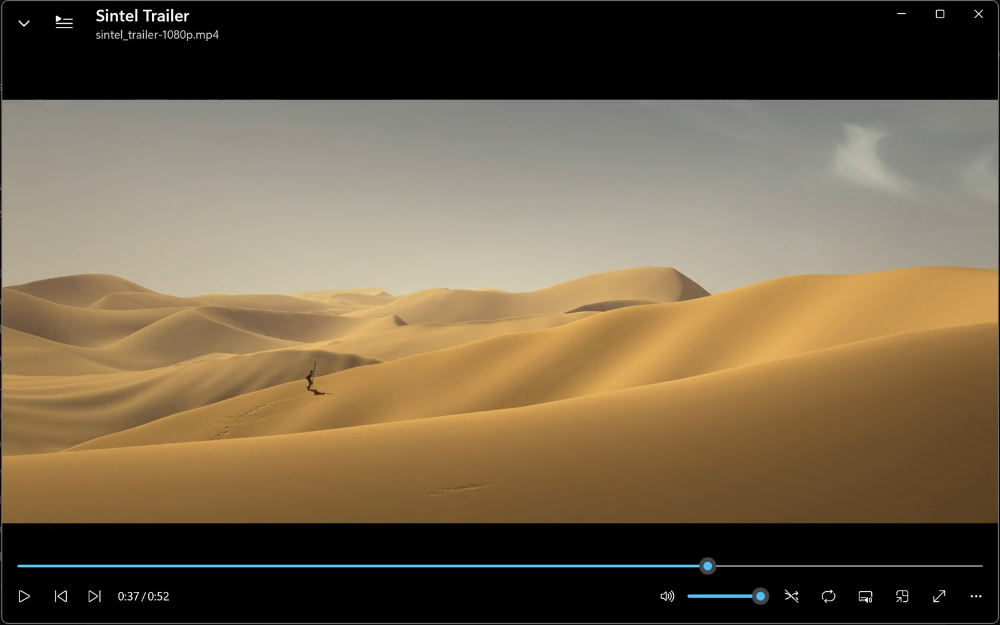
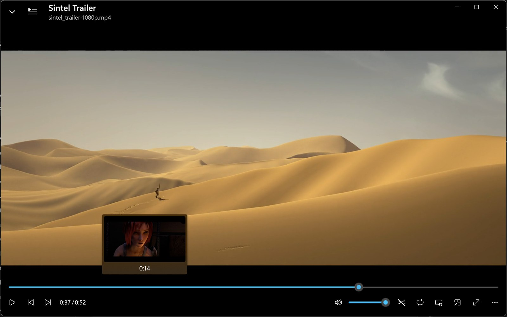
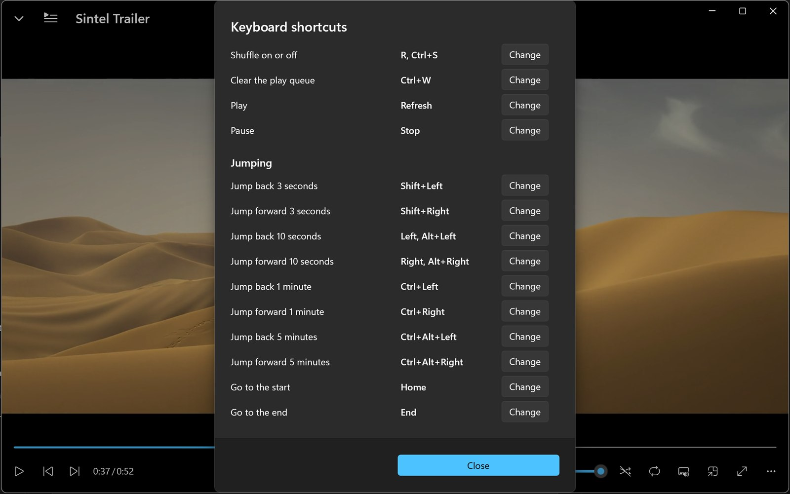
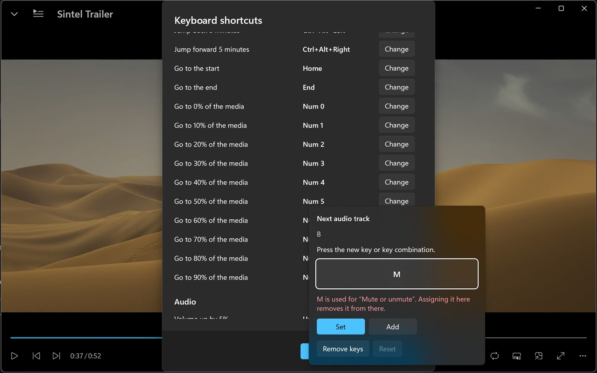
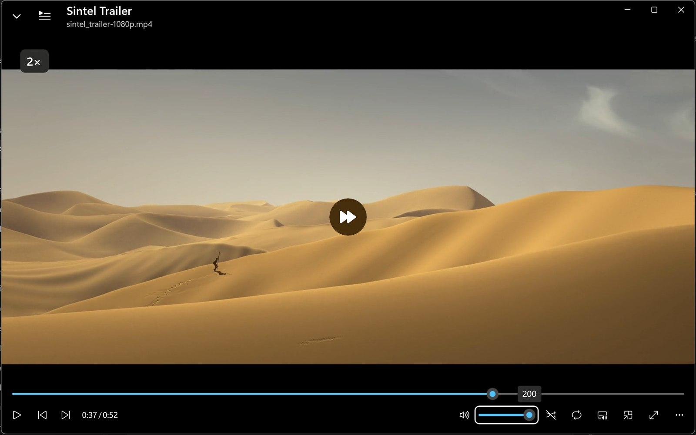
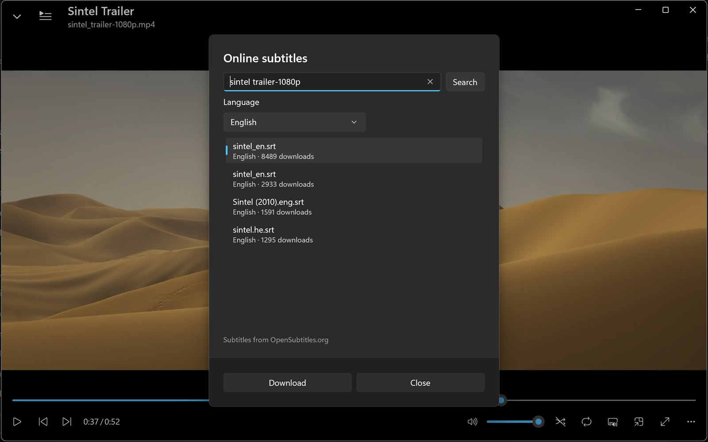
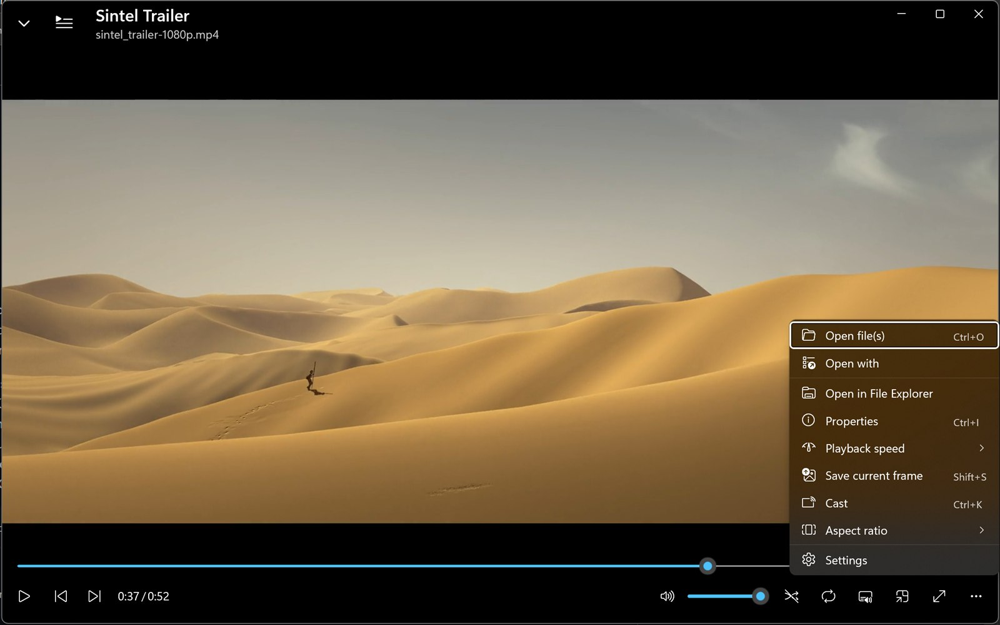

<p align="center">
  
</p>
<h1 align="center">
  Screenbox, VLC edition
</h1>
<p align="center">
  The modern Windows media player, with the keyboard, volume and subtitle habits of VLC
</p>
<p align="center">
  <a href="https://github.com/ganpatig/Screenbox/releases/latest"><b>⬇ Download the latest release</b></a>
  &nbsp;·&nbsp;
  <a href="#install">How to install</a>
  &nbsp;·&nbsp;
  <a href="#whats-different-from-the-original">What's different</a>
</p>

> [!NOTE]
> This is a fork of [Screenbox](https://github.com/huynhsontung/Screenbox) by Tung H. Screenbox is a clean, fast, modern player; this fork keeps all of that and adds the things VLC users miss when they switch. The Microsoft Store version of Screenbox is the original app, not this fork.



## Why use this fork

- **Your VLC muscle memory works.** `Space`, `+` `-` `=` for speed, `Shift`/`Alt`/`Ctrl` + arrows for 3 s / 10 s / 1 min jumps, `E` for the next frame, `V` and `B` for subtitle and audio tracks, `G` `H` `J` `K` for delays, and dozens more, all the same as VLC 3.0.
- **Any key can be changed.** A built-in shortcut editor lets you reassign every action and warns you before a key is taken from another one.
- **You see where you are seeking.** The seek bar shows the actual frame under the pointer, not just a time.
- **Subtitles in two clicks.** Search OpenSubtitles from inside the player; no browser, no unzipping.
- **It remembers.** Each video reopens with the audio and subtitle tracks you picked, and new videos start in English when they have an English track.
- **Loud when you need it.** Volume goes to 200% out of the box.

## What's different from the original

| | Original Screenbox | This fork |
|---|---|---|
| Keyboard shortcuts | YouTube-style (`J` `L` seek, `K` play, `+` `-` volume) | VLC 3.0 layout, about 90 shortcuts |
| Change shortcuts | No | Yes, every shortcut, with conflict warnings |
| Seek bar preview | Time only | Thumbnail of the exact frame |
| Playback speed keys | `Shift+.` `Shift+,` (0.25× steps) | VLC's `+` `-` `=` `[` `]`, and the original two |
| Maximum volume | 100% (200% if you turn on volume boost) | 200% by default |
| Rewind and fast forward step | 5 seconds | 10 seconds, plus 3 s, 1 min and 5 min jumps |
| Online subtitles | No | Search and load from OpenSubtitles |
| Audio and subtitle track memory | Last subtitle language only | Audio and subtitle track per video, English audio preferred |
| Picture-in-picture size | Opens small, size not remembered | As large as Windows allows, remembers your size |
| Go to a time | No | `Ctrl+T` |
| Settings from the player | No | In the player's ⋯ menu |
| Delay, subtitle sync, crop, zoom, deinterlace keys | No (frame step and chapter keys only) | All of them, as in VLC |

Everything else, from the library and playlists to casting and the Fluent design, is the original app.

## The features

### Frame-accurate seek previews

Hover over the seek bar to see the frame at that point. While you move, the nearest keyframe follows the pointer so the preview keeps up; when you stop, the exact frame replaces it.



### VLC keyboard shortcuts, and you can change any of them

Press `F1` in the player, or open **Settings › Player › Keyboard shortcuts › Customize**, to see every shortcut.



Select **Change**, press the new key, then **Set** to replace the keys or **Add** to keep the old ones too. If the key already belongs to another action, you're told before anything changes.



### Playback speed and 200% volume

`+` and `-` step through VLC's speeds (1.5×, 2×, 3×…), `=` goes back to normal, and `[` `]` adjust by 0.1×. The current speed appears in the corner. Volume goes up to 200%.



### Online subtitles

Open **Audio & captions › Add subtitle from online**. The search is filled in from the file name; pick a language, pick a result, and select **Download**. The subtitle is added to the video that's playing.



### Settings from the player, and more

The player's ⋯ menu now has **Settings**, and it shows the shortcut for each item.



Also in this fork:

- **Remembered tracks.** Change the audio or subtitle track of a video and it's selected again the next time you play that video.
- **Bigger picture-in-picture.** Picture-in-picture (`Ctrl+M`) opens as large as Windows allows, which is 500 by 500 effective pixels and at most half the screen. Drag it to the size you like and it reopens at that size.
- **Go to time.** `Ctrl+T` asks for a time and jumps there.
- **Hold `Space`** to play at double speed for as long as you hold it.
- **Fixes** for crashes when opening a video from the Recent list, and a crash log in the app's temporary folder for any that remain.

New text in this fork is in English only; other languages show it in English until it is translated.

<sub>Screenshots show the trailer of [Sintel](https://durian.blender.org/), © copyright Blender Foundation, licensed under [CC BY 3.0](https://creativecommons.org/licenses/by/3.0/).</sub>

## Install

1. Download `Screenbox-VLC-Edition-<version>-x64.zip` from the [latest release](https://github.com/ganpatig/Screenbox/releases/latest) and extract it.
2. Right-click `Install-Screenbox.ps1` and select **Run with PowerShell**. Accept the administrator prompt.

The script trusts the certificate the app is signed with (`Screenbox.cer`, in **Local Machine › Trusted People**), installs the two Microsoft packages it needs if they're missing, and installs Screenbox. Updating works the same way and keeps your settings and library.

> [!IMPORTANT]
> The app is signed with a self-signed certificate rather than one from a certificate authority, so Windows needs to be told to trust it, which is the step that needs administrator rights. The certificate is only for code signing. If you'd rather not trust it, build the app yourself as described under [Quick Start for Developers](#quick-start-for-developers).

To uninstall, open **Settings › Apps › Installed apps**, find **Screenbox**, and select **Uninstall**.

Requirements: Windows 10 version 1903 or later, or Windows 11, on an x64 PC.

## About Screenbox

<p>
  <a href='https://apps.microsoft.com/detail/9NTSNMSVCB5L?cid=storebadge&mode=mini'>
    <picture>
      <source media="(prefers-color-scheme: dark)" srcset="https://get.microsoft.com/images/en-us%20light.svg">
      <source media="(prefers-color-scheme: light)" srcset="https://get.microsoft.com/images/en-us%20dark.svg">
      
    </picture>
  </a>
</p>

The badge above installs the original Screenbox from the Microsoft Store.

Screenbox is a modern video player that cares about performance and ease of use on a wide range of device types. It features a beautiful, friendly user interface that is fast and lightweight. Screenbox is available on Windows 10 version 1903 and up, Windows 11, and Xbox consoles.

Screenbox is built on top of [LibVLCSharp](https://github.com/videolan/libvlcsharp) and the Universal Windows Platform (UWP).

<picture>
  <source media="(prefers-color-scheme: dark)" srcset="/assets/images/docs/PC-HeroHomePage-Dark.png?raw=true">
  <source media="(prefers-color-scheme: light)" srcset="/assets/images/docs/PC-HeroHomePage-Light.png?raw=true">
  
</picture>


Some notable features:

- Fluent design user interface
- Gesture support for seeking and changing volume
- Window resize hotkeys (number row `1`-`4`)
- YouTube-inspired hotkey layout
- Picture-in-picture mode
- Save the video frame as an image
- Chromecast support
- Browse and play media over the network

And many more on the way!

### Installing the original Screenbox

The recommended way to install the original Screenbox is through the [Microsoft Store](https://www.microsoft.com/store/apps/9NTSNMSVCB5L). Installing through the store ensures the app stays up to date automatically. You don't need a Microsoft account to download apps from the store. The app can also be installed through winget using the following command.

```shell
winget install screenbox -s winget
```

## Contribute

Feel free to open an issue if you want to report a bug, give feedback, or ask a question. PRs are very welcome!

### For Contributors

- 📖 **[Contributing Guide](CONTRIBUTING.md)** - Complete guide for new contributors
- 🏗️ **[Project Structure](docs/PROJECT_STRUCTURE.md)** - Detailed codebase architecture overview

### Quick Start for Developers

1. **Prerequisites**: Visual Studio 2026 with UWP development workload
2. **Clone**: `git clone https://github.com/ganpatig/Screenbox.git` (this fork) or `git clone https://github.com/huynhsontung/Screenbox.git` (the original)
3. **Build**: Open `Screenbox.slnx` and build the solution (Ctrl+Shift+B)
4. **Run**: Set platform to x64 and start debugging (F5)

See the [Contributing Guide](CONTRIBUTING.md) for detailed setup instructions.

## Translation

[](https://crowdin.com/project/screenbox)

Help translate the app to your language on [Crowdin](https://crowdin.com/project/screenbox)! Crowdin offers an intuitive UX for you to get started and is the recommended tool for localization. Translations are automatically synced to GitHub and published in the next minor update.

You can also translate the app locally without Crowdin. The project source language is English, United States. All localizable source files are in the `Screenbox\Strings\en-US` directory. Localizable file types are `.resw` and `.md`.

Make sure you have your translations in the appropriate folder under the `Screenbox\Strings` directory. We use a [IETF language tag](https://www.venea.net/web/culture_code) to name the folder that contains resources for that language (e.g. `fr-FR` for French (France), `es-ES` for Spanish (Spain)). Files in these folders are translated copies of the original resource files in `Screenbox\Strings\en-US`.

A typical workflow for translating resources:

1. Fork and clone this repo.
1. Create a folder for your language under `Screenbox\Strings` if there isn't one already.
1. Copy over any missing files from the `en-US` folder. 
1. Translate the `.resw` and `.md` files in the directory.
1. Once you're done, commit your changes, push to GitHub, and make a pull request.
